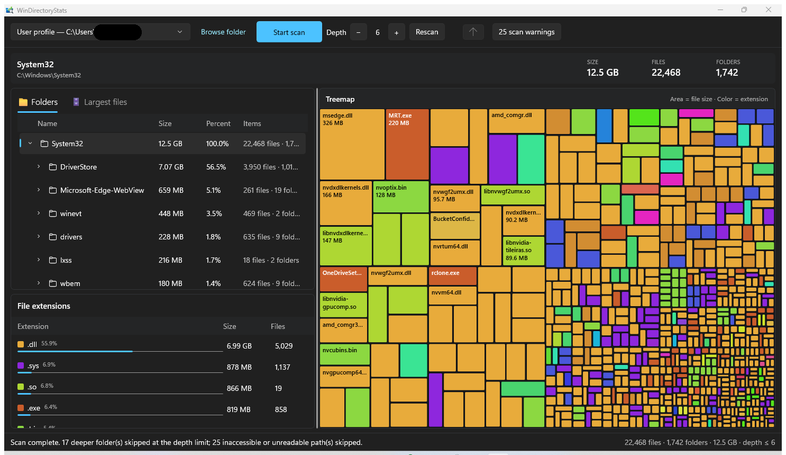

<div align="center">

# 📊 WinDirectoryStats

**A fast, native WinUI 3 disk-usage analyzer for Windows — scan drives, browse folder trees, and explore an interactive extension-colored treemap.**


[](https://github.com/uponatime2019/WinDirectoryStats/releases/latest)




</div>

---

## 📥 Download & run — no install needed

The quickest way to find out what's eating your disk:

1. Grab **`WinDirectoryStats-vX.Y.Z-win-x64.zip`** from the [latest release](https://github.com/uponatime2019/WinDirectoryStats/releases/latest)
2. Right-click → **Extract All…**
3. Double-click **`WinDirectoryStats.exe`** — that's it. Portable, no installer, no admin rights, and no .NET download required (the runtime is bundled).

> **First launch?** Windows SmartScreen may show *"Windows protected your PC"* because the app isn't code-signed — click **More info → Run anyway**.

---

## ✨ Features

- **🔍 Non-blocking scans** — scan any local drive or folder without freezing the UI, with live progress and a cancel button.
- **🌲 Configurable traversal depth** — limit how deep the scan goes before it starts (1–128 levels, default 6); the status reports how many deeper folders were skipped.
- **📁 Lazy folder tree** — browse a lazily populated directory tree with sizes, percentages, and item totals; rescan or step up with one click.
- **🏷️ Largest-files view** — inspect and filter the biggest files in the selected directory.
- **🎨 Extension statistics** — totals, file counts, and percentages per extension, with stable colors per extension.
- **🗺️ Interactive treemap** — an extension-colored treemap (custom-built panel) showing at a glance where the space goes; open files, reveal them in Explorer, copy paths, or send them to the Recycle Bin after confirmation.
- **🛡️ Robust traversal** — skips reparse points, continues past inaccessible paths, and collects errors for review.
- **⚡ Single instance** — launching a second instance restores the first; a folder can also be passed as a command-line argument.

## 🏗️ Architecture

```
WinDirectoryStats/
├── App.xaml(.cs)            # Entry point, single-instance mutex, crash logging
├── MainWindow.xaml(.cs)     # Drive picker, scan controls, results tabs, treemap + details layout
├── Controls/
│   └── TreemapPanel.cs      # Custom layout panel that draws the interactive extension-colored treemap
├── Services/
│   └── DiskScanner.cs       # Cancellable, depth-limited, reparse-point-aware filesystem walker
├── Models/                  # DiskItem, DriveOption, ExtensionStat
└── Helpers/                 # Extension color palette, human-readable size formatting
```

Scans run off the UI thread via `IProgress<T>` reporting; the treemap is a custom `Panel` subclass laid out with a squarified arrangement, so it scales with the window and stays interactive (click to select, double-click to act).

## 🧰 Technology stack

| Layer | Technology |
|---|---|
| UI framework | WinUI 3 (Windows App SDK 2.4), native Fluent styling |
| Runtime | .NET 8 (`net8.0-windows10.0.19041.0`) |
| Filesystem scanning | Hand-written cancellable walker (no recursive APIs) |
| Treemap | Custom WinUI 3 `Panel` — no third-party dependencies |

> WinDirectoryStats is an independent project inspired by the interaction model of [WinDirStat](https://github.com/windirstat/windirstat). It is not affiliated with the WinDirStat team and does not copy the upstream MFC/C++ implementation or branding assets.

## 📋 Prerequisites

- Windows 10 version 1809 (build 17763) or later — Windows 11 recommended
- [.NET 8 SDK](https://dotnet.microsoft.com/download/dotnet/8.0) (for building from source)
- Visual Studio 2022 with the **WinUI application development** workload (optional, for the IDE experience)

> **Unpackaged app:** WinDirectoryStats runs as a plain `.exe` — no MSIX package, no developer mode, no signing certificate required. The Windows App SDK runtime is bundled with the build.

## 🔨 Build & run

```bash
# Restore + build (x64)
dotnet build WinDirectoryStats.csproj -p:Platform=x64

# Run
dotnet run --project WinDirectoryStats.csproj -p:Platform=x64

# Other platforms
dotnet build WinDirectoryStats.csproj -p:Platform=x86
dotnet build WinDirectoryStats.csproj -p:Platform=ARM64

# Self-contained publish (x64)
dotnet publish WinDirectoryStats.csproj -c Release -p:Platform=x64
```

Or open `WinDirectoryStats.sln` in Visual Studio 2022, pick **x64**, and press **F5**.

## ⌨️ Controls

| Action | How |
|---|---|
| Start a scan | Pick a drive (or browse for a folder) → **Scan** |
| Scan a specific folder | Pass it as a command-line argument, or use the folder browse button |
| Adjust scan depth | **−** / **+** next to the depth counter (1–128 levels) |
| Cancel an active scan | **Cancel** button |
| Rescan the current location | **Rescan** button |
| Go up one level | **Up** button |
| Review scan warnings | **Errors** button (skipped/inaccessible paths) |
| Act on a file | Right-click in the treemap or lists → open, reveal in Explorer, copy path, or recycle |

## 🗺️ Roadmap

- [ ] **Live treemap updates while scanning** — watch the map build in real time
- [ ] **Duplicate file finder** — content-hash based duplicate detection
- [ ] **Scan history & comparison** — snapshot a drive and diff it over time
- [ ] **Jump-to-folder from treemap zoom** — navigate the map like the classic WinDirStat
- [ ] **Export reports** — CSV/JSON export of scan results
- [ ] **Dark/light theme toggle** — follow or override the system theme
- [ ] **Localization** — the UI is currently English-only

Want something on this list sooner? Open an issue (or a PR 😉) and say so — the roadmap is flexible.

## 🤝 Contributing

Contributions are **very welcome** — code, bug reports, documentation, and feature ideas all count. It's a small, focused codebase (one window, one scanner, one custom control), so it's easy to find your way around.

- 🐛 **Found a bug?** Open an issue with your Windows version and steps to reproduce (crash details land in `%LOCALAPPDATA%\WinDirectoryStats\crash.log`).
- 💡 **Have an idea?** Open a feature request or lobby for a roadmap item.
- 🔧 **Want to hack on it?** Fork → branch (`git checkout -b feature/my-feature`) → build with the command above → keep the existing style (nullable enabled, small focused classes) → open a PR describing what changed and why.

> By contributing, you agree that your contributions will be licensed under the [MIT License](LICENSE).

## 🔒 Privacy

WinDirectoryStats is fully local. It has **no telemetry, no analytics, and no network access** — it only reads the filesystem locations you ask it to scan. Crash details (if any) are written locally to `%LOCALAPPDATA%\WinDirectoryStats\crash.log` and never leave your machine.

## 📄 License

Released under the [MIT License](LICENSE).
